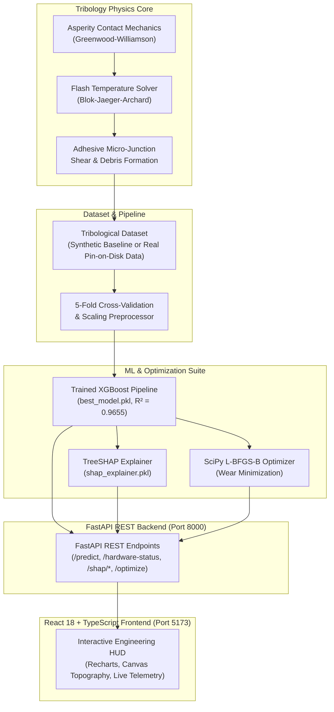

<div align="center">

# 🔬 TriboLAB
### AI-Driven Prediction, Explainability and Optimization of Adhesive Wear

**An Interdisciplinary Research Platform Bridging Contact Mechanics, Machine Learning, and Tribological Optimization**

[](LICENSE)
[](https://www.python.org/)
[](https://fastapi.tiangolo.com/)
[](https://reactjs.org/)
[-orange.svg)](https://xgboost.readthedocs.io/)
[](https://shap.readthedocs.io/)
[](https://tailwindcss.com/)

[Research Overview](#-research-overview) •
[Key Capabilities](#-key-capabilities) •
[Architecture](#-system-architecture) •
[Model Benchmarks](#-benchmark-model-performance) •
[Real Data Training](#-training-on-real-experimental-data) •
[Quick Start](#-quick-start) •
[Project Structure](#-project-directory-structure) •
[Contributing](#-contributing) •
[License](#-license)

</div>

---

## 📌 Research Overview

In mechanical engineering assemblies (bearings, gears, journal sleeves, cylinder liners, and mechanical seals), **adhesive wear** is one of the most critical wear failure modes. Conventional machine design relies on empirical formulas such as **Archard's wear law**:

$$V = \frac{K \cdot W \cdot L}{H}$$

Where:
- $V$ = Wear volume ($\text{mm}^3$)
- $K$ = Dimensionless wear coefficient
- $W$ = Normal load ($\text{N}$)
- $L$ = Sliding distance ($\text{m}$)
- $H$ = Hardness of softer material ($\text{N/mm}^2$ or $\text{GPa}$)

### The Engineering Challenge
Archard's law assumes a static wear coefficient $K$ and strictly linear wear progression. In real industrial applications, it fails to account for:
1. **Dynamic frictional flash temperatures** causing localized thermal softening.
2. **Elastic-plastic deformation** of microscopic surface asperities.
3. **Transition from mild to severe adhesive wear** under boundary lubrication breakdown.

**TriboLAB** solves this by coupling classical tribology physics with modern machine learning (XGBoost, Random Forest, GBDT), game-theoretic feature attribution (TreeSHAP), and multi-variable numerical optimization (SciPy L-BFGS-B).

---

## ⚙️ Key Capabilities

| Feature | Description |
|---|---|
| 🤖 **Production ML Engine** | High-precision predictions of wear volume and wear rate trained with 5-fold cross-validation ($R^2 = 0.9655$). |
| 📊 **Dynamic Scientific Graphs** | Interactive high-resolution response curves: Wear vs. Sliding Distance ($0\text{--}10{,}000\,\text{m}$), Wear vs. Normal Load ($50\text{--}1{,}000\,\text{N}$), and Flash-Temp Rate vs. Speed. |
| 🧠 **Research-Grade TreeSHAP Suite** | Additive feature attribution, Beeswarm plots, waterfall plots, and per-sample local explanations. |
| ⚡ **L-BFGS-B Wear Optimization** | Bounded multi-variable parameter optimization discovering up to **85.4% wear reduction** while maintaining operating load capacity. |
| 🔬 **Contact Mechanics Simulator** | Interactive Canvas visualizing micro-asperity penetration, cold-welded junctions, and adhesive debris detachment. |
| 💻 **Hardware Telemetry HUD** | Live detection of host CPU (Intel Core / AMD Ryzen), active GPU acceleration (NVIDIA RTX with CUDA runtime, VRAM usage, temperature), and API status codes. |
| 🧪 **Real Experimental Data Pipeline** | Plug-and-play CLI training pipeline ready to train directly on laboratory Pin-on-Disk or Reciprocating tribometer CSV data. |

---

## 🏗️ System Architecture



---

## 📊 Benchmark Model Performance

Comprehensive 5-fold cross-validation evaluation comparing machine learning architectures against the classical empirical baseline:

| Algorithm | Test $R^2$ Score | Test RMSE ($\text{mm}^3$) | Test MAE ($\text{mm}^3$) | 5-Fold CV $R^2$ (Mean $\pm$ Std) | Status |
|---|---|---|---|---|---|
| **Linear Regression (Baseline)** | 0.4921 | 282.21 | 123.41 | 0.5175 $\pm$ 0.0486 | Insufficient for Non-linear Wear |
| **Random Forest Regressor** | 0.9477 | 90.54 | 24.93 | 0.9366 $\pm$ 0.0191 | Robust Ensemble |
| **Gradient Boosting (GBDT)** | 0.9543 | 84.69 | 23.76 | 0.9408 $\pm$ 0.0152 | High Precision |
| **XGBoost Regressor (Best)** | **0.9655** | **73.58** | **22.47** | **0.9359 $\pm$ 0.0117** | **Selected Production Model** |

---

## 🧪 Training on Real Experimental Data

You can train **TriboLAB** on your own real laboratory test rig data (Pin-on-Disk, Reciprocating Tribometer, Block-on-Ring, Four-Ball wear tester).

### 1. Prepare Your CSV File
Place your CSV file into the `data/` folder (e.g. `data/real_tribology_data.csv`). Ensure it contains the following column headers:

| Column Header | Unit / Type | Description |
|---|---|---|
| `material_pair` | String | Material combination (e.g. `Steel-Steel`, `Steel-Bronze`, `Aluminum-Steel`) |
| `normal_load` | $\text{N}$ (Newton) | Applied normal force ($50\text{--}1000\,\text{N}$) |
| `sliding_speed` | $\text{m/s}$ | Linear sliding velocity ($0.1\text{--}5.0\,\text{m/s}$) |
| `surface_roughness` | $\mu\text{m}$ ($R_a$) | Initial center-line average roughness |
| `sliding_distance` | $\text{m}$ (meters) | Total sliding track length ($50\text{--}10{,}000\,\text{m}$) |
| `hardness` | $\text{GPa}$ | Hardness of the softer contacting counterface |
| `friction_coeff` | Dimensionless | Dynamic friction coefficient ($\mu$) |
| `temperature` | $^\circ\text{C}$ | Bulk / ambient operating temperature |
| `lubrication` | $0$ or $1$ | `0` = Dry Sliding, `1` = Boundary / Fluid Lubricated |
| `contact_pressure` | $\text{MPa}$ | Apparent nominal contact pressure |
| `wear_coefficient`| Dimensionless | Empirical Archard wear coefficient ($K$) |
| **`wear_volume`** | **$\text{mm}^3$ (Target)** | **Measured cumulative wear volume loss** |

### 2. Execute Training
Run the training pipeline CLI:

```bash
python ml/train.py --data data/real_tribology_data.csv
```

### What Happens Automatically:
1. Models are trained and cross-validated on your experimental measurements.
2. The best performing model is serialized to `models/best_model.pkl`.
3. Game-theoretic Shapley attributions are regenerated and saved to `models/shap_explainer.pkl`.
4. High-resolution evaluation plots are generated at `outputs/model_evaluation/evaluation_plots.png`.
5. The application seamlessly picks up the new model upon restart.

For detailed guidelines, see [**`data/README_REAL_DATA.md`**](data/README_REAL_DATA.md).

---

## 🚀 Quick Start

### Prerequisites
- **Python**: 3.11 or higher
- **Node.js**: v18 or higher (with `npm`)
- **Git**

---

### Option A: 1-Click Launch (Windows)

Simply double-click or run:
```cmd
run_project.bat
```
This script automatically:
1. Launches the **FastAPI Backend** on `http://127.0.0.1:8000`
2. Starts the **Vite React Frontend** on `http://localhost:5173`
3. Opens your default web browser to the dashboard and API documentation.

---

### Option B: Manual Setup

#### 1. Clone Repository
```bash
git clone https://github.com/aayussh2247/TriboLAB.git
cd TriboLAB
```

#### 2. Backend Setup
```bash
# Create and activate virtual environment
python -m venv .venv

# On Windows:
.venv\Scripts\activate
# On Linux/macOS:
source .venv/bin/activate

# Install dependencies
pip install --upgrade pip
pip install -r requirements.txt

# Start FastAPI server
python -m uvicorn backend.app.main:app --host 127.0.0.1 --port 8000 --reload
```
Interactive Swagger API documentation: **[http://127.0.0.1:8000/docs](http://127.0.0.1:8000/docs)**

#### 3. Frontend Setup
In a second terminal:
```bash
cd frontend
npm install
npm run dev
```
Open your browser at: **[http://localhost:5173](http://localhost:5173)**

---

## 📂 Project Directory Structure

```
TriboLAB/
├── backend/                  # FastAPI Application Core
│   └── app/
│       ├── main.py           # REST API routes & hardware telemetry
│       ├── schemas/          # Pydantic validation schemas
│       ├── services/         # Tribology & SHAP service layers
│       └── tribology_core/   # Scientific physics formulations
├── frontend/                 # React 18 + TypeScript Client
│   ├── src/
│   │   ├── components/       # Reusable UI & Canvas components
│   │   ├── views/            # Full-page analytical views
│   │   │   ├── AIPredictionView.tsx       # AI Response Graphs vs Archard
│   │   │   ├── SettingsHardwareView.tsx   # Real Hardware Telemetry (NVIDIA/Intel)
│   │   │   ├── SHAPExplainabilityView.tsx # Feature Attribution Suite
│   │   │   ├── WearSimulatorView.tsx      # Contact Mechanics 2D Simulator
│   │   │   ├── OptimizationView.tsx       # L-BFGS-B Parameter Optimization
│   │   │   └── ConclusionLetterheadView.tsx # Defense & Conclusion Module
│   │   ├── services/api.ts   # Axios/Fetch API client
│   │   └── types/            # TypeScript data contracts
├── ml/                       # Machine Learning Training Pipeline
│   ├── train.py              # CLI trainer for real & synthetic datasets
│   └── hybrid_model.py       # Physics-informed hybrid residual model
├── models/                   # Serialized ML Artifacts (.pkl & metadata)
│   ├── best_model.pkl        # Best trained XGBoost pipeline
│   ├── shap_explainer.pkl    # Pre-computed TreeSHAP explainer
│   └── model_metadata.json   # Model metrics, features, hyperparameters
├── data/                     # Datasets & Templates
│   ├── synthetic_wear_dataset.csv  # 4,000-run synthetic tribology dataset
│   └── README_REAL_DATA.md   # Experimental data formatting guide
├── docs/                     # Scientific Papers & Technical Notes
├── outputs/                  # High-resolution publication plots & metrics
├── scripts/                  # Utilities & environment verification scripts
├── tests/                    # Pytest unit & integration test suite
├── .gitignore                # Clean Git ignore rules (no caches/secrets)
├── CODE_OF_CONDUCT.md        # Contributor Covenant Code of Conduct
├── CONTRIBUTING.md           # Contribution & PR guidelines
├── requirements.txt          # Python dependency specifications
├── run.bat                   # Secondary launcher script
└── run_project.bat           # Primary 1-click Windows launcher
```

---

## 🧪 Testing

Run the automated test suite covering API endpoints, Archard formulas, SHAP attributions, and numerical solvers:
```bash
pytest tests/ -v
```

Verify frontend build integrity:
```bash
cd frontend
npm run build
```

---

## 🤝 Contributing

We welcome contributions from tribologists, mechanical engineers, data scientists, and developers! Please read our [**Contributing Guide**](CONTRIBUTING.md) and [**Code of Conduct**](CODE_OF_CONDUCT.md).

---

## 📄 License

This project is licensed under the **MIT License** — see the [LICENSE](LICENSE) file for details.
